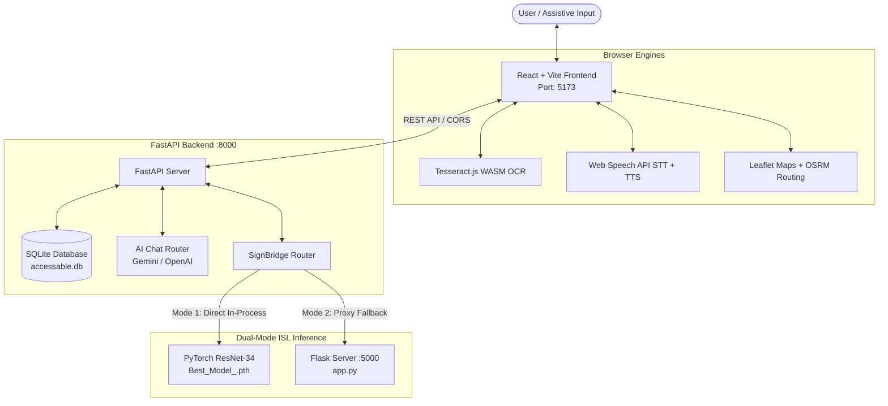

# AccessAble AI — Unified Accessibility Platform

AccessAble AI is an inclusive digital accessibility platform built to empower individuals with visual, hearing, speech, mobility, and situational disabilities. It brings together assistive computer vision, community crowdsourced navigation, emergency coordination, speech-to-text live captioning, and Indian Sign Language AI into a unified, high-contrast, accessible application.

---

## 1. Unified Modules & Features

1. **VisionMate (Visual Assistance & OCR)**:
   - Client-side Optical Character Recognition via Tesseract.js (WebAssembly).
   - Instant speech playback via browser `SpeechSynthesisUtterance`.
   - Adjustable font scaling, speed slider, and high-contrast reader mode.

2. **AccessRoute (Accessible Maps, Barriers & Spoken Navigation)**:
   - Interactive Leaflet map with OpenStreetMap tiles.
   - **Community Barrier Crowdsourcing**: Report obstacles (stairs, broken elevators, construction, curb cuts) with severity, affected user groups (wheelchair, visually impaired, stroller, elderly), photo URLs, and detour advice.
   - **Crowd Verification Workflow**: Community members can confirm, resolve, or flag reports.
   - **Turn-by-Turn Spoken Navigation**: Route calculation via OSRM walking engine with real-time audio maneuvers and nearby barrier proximity alerts.

3. **SafeReach SOS (Emergency Assistance)**:
   - High-contrast, intentional confirmation modal preventing accidental emergency triggers.
   - Quick one-click geolocation insertion.
   - Multi-channel delivery: Web Share API, SMS links, clipboard copy fallback, and persistent local SQLite audit history.

4. **SignBridge AI (Indian Sign Language Recognition)**:
   - Powered by a pretrained 82-class PyTorch ResNet-34 model (`Best_Model_.pth`, 85.4MB).
   - **Dual-Mode Inference Engine**: Transparently proxies to the local Flask server (`app.py` on port 5000) or runs in-process inside FastAPI with zero external server dependencies.
   - Camera viewport with a centered alignment guide box and 128x128 square cropping for hand recognition.
   - Staged sentence transcript builder with speech output.

5. **Live Captions (Real-Time Speech-to-Text)**:
   - Powered by browser Web Speech API (`SpeechRecognition`).
   - Designed for deaf and hard-of-hearing users during meetings, lectures, and conversations.
   - Real-time pause/resume, transcript export, and audio playback.

6. **AccessAble AI Assistant (Conversational Copilot)**:
   - ChatGPT-like conversational assistant in a floating drawer.
   - Supports Google Gemini (`GEMINI_API_KEY`) and OpenAI (`OPENAI_API_KEY`) with transparent fallback to platform context knowledge.
   - Platform tool-calling shortcuts: jump directly to any module, suggest accessible routes, and explain emergency protocols.

---

## 2. Design System & Accessibility Palette

Adheres to WCAG 2.1 AAA contrast ratios:
- **Primary Deep Blue**: `#1E3A8A`
- **Focus / Accent Yellow**: `#FACC15`
- **Backgrounds**: Light mode `#F8FAFC`, Dark mode `#0F172A`, High-Contrast `#000000`
- **Text**: Pure Black `#000000`, Crisp White `#FFFFFF`, High-contrast Yellow `#FACC15`
- **Typography & Icons**: Dynamic typography scaling (100% to 145%) and clean vector icons via `lucide-react` (zero corrupted question-mark glyphs).

---

## 3. Architecture Overview



---

## 4. Quick Start & Launch

### One-Click Launch (Recommended)
Run the master launcher in the project root:
```bash
python AccessAbleAI.py
```
This automatically:
1. Launches the FastAPI backend on `http://127.0.0.1:8000`.
2. Starts the Vite frontend on `http://127.0.0.1:5173`.
3. Opens AccessAble AI in your default web browser.

---

### Manual Launch

**Backend:**
```bash
cd backend
python -m uvicorn app.main:app --host 127.0.0.1 --port 8000 --reload
```

**Frontend:**
```bash
cd frontend
npm run dev
```

Visit: `http://localhost:5173`

---

## 5. Running Automated Tests

To run the backend test suite:
```bash
cd backend
python -m pytest tests/test_api.py -v
```
All 8 verification tests cover:
- Health status and barrier count reporting
- Community barrier seeding and retrieval
- New obstacle report creation with severity and affected groups
- Haversine distance-based nearby obstacle queries
- Community barrier confirmation, resolution, and flagging
- SafeReach SOS audit log recording
- SignBridge status and dual-mode readiness
- AccessAble AI chat responses and navigation intents

---

## 6. Privacy & Safety Commitments
- **Zero Mandatory Cloud AI Keys**: All core features (OCR, maps, voice, ISL sign recognition, SOS) run locally.
- **No Video Storage**: Camera feeds are processed entirely in memory.
- **Honest Status Disclosure**: SafeReach and AccessRoute indicate exact status without falsifying emergency dispatches or municipal approvals.
